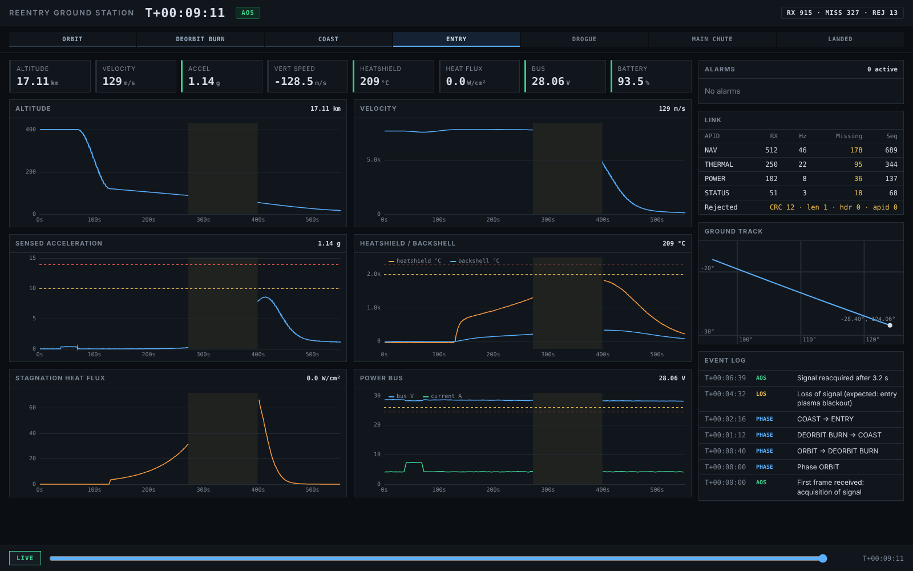
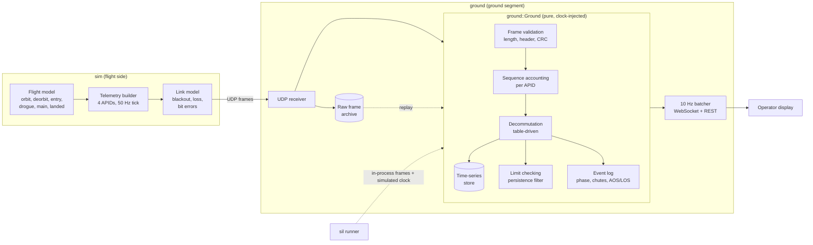
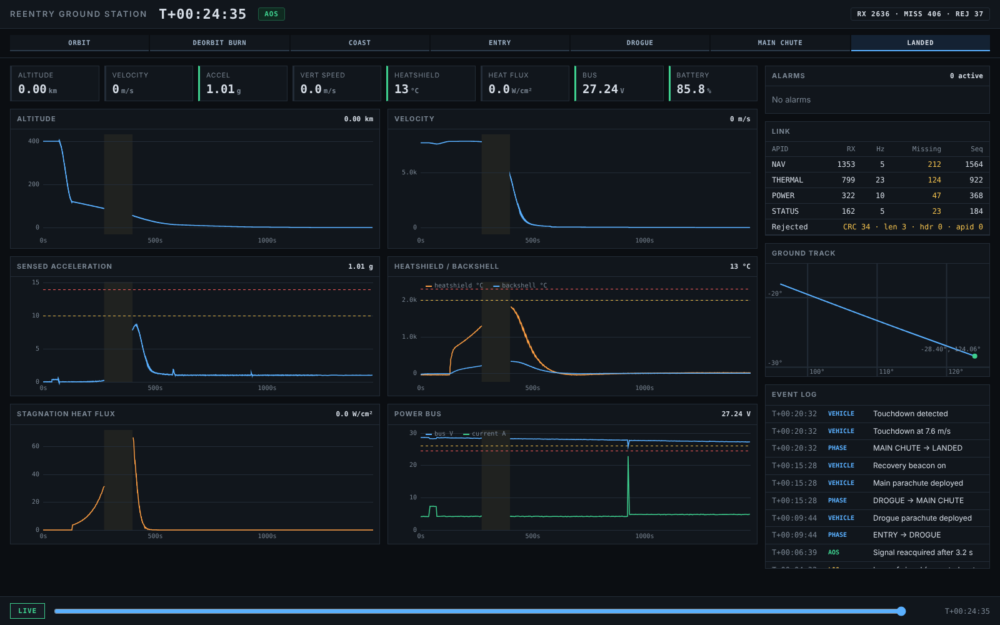

# Reentry Telemetry: a ground segment for a cargo reentry capsule

A complete, test-driven ground software stack for a small reentry vehicle, written in Rust:

- a **flight simulator** that flies a capsule from orbit to touchdown and downlinks CCSDS-style telemetry over UDP,
- a **ground station** that validates every frame, accounts for every lost packet, decommutates measurements, checks flight rules, and detects loss and reacquisition of signal,
- a **real-time operator display** in the browser, with replay,
- a **raw frame archive** that can be replayed bit-for-bit through the ground software, and
- a **software-in-the-loop (SIL) test runner** that flies fault scenarios headless and verifies the ground station's conclusions against the simulator's ground truth.



> Independent project. Not affiliated with, endorsed by, or built with any information from Inversion Space. Everything here is built from public physics and public standards. It was built to explore the kind of ground software a reentry vehicle program needs: telemetry parsers, real-time operator displays, time-series storage, and HIL/SIL automation.

## Contents

- [Quick start](#quick-start)
- [Architecture](#architecture)
- [Wire protocol](#wire-protocol)
- [Flight model](#flight-model)
- [Ground segment](#ground-segment)
- [Operator display](#operator-display)
- [Archive and replay](#archive-and-replay)
- [Software-in-the-loop testing](#software-in-the-loop-testing)
- [Design decisions](#design-decisions)
- [Limitations and next steps](#limitations-and-next-steps)
- [Repository layout](#repository-layout)

## Quick start

Requires a recent stable Rust toolchain (edition 2024).

```bash
# 1. Ground station: listens on udp://0.0.0.0:7000, display on http://127.0.0.1:8080
cargo run --release -p ground -- --archive runs/pass-001.jsonl

# 2. In a second terminal, fly the capsule at 10x real time
cargo run --release -p sim

# Fly with a degraded link and a failed main parachute
cargo run --release -p sim -- --drop 0.05 --corrupt 0.02 --fail-main

# 3. Run the SIL suite (about 0.1 s for all scenarios)
cargo run --release -p ground --bin sil

# Unit tests
cargo test --workspace
```

Open http://127.0.0.1:8080 while the simulator is flying. A nominal flight takes about two minutes at the default 10x time compression.

### Simulator options

| Flag | Default | Meaning |
|---|---|---|
| `--target` | `127.0.0.1:7000` | Ground station UDP address |
| `--speed` | `10` | Mission seconds per wall-clock second |
| `--seed` | `7` | PRNG seed. The same seed gives an identical flight and an identical link. |
| `--drop` | `0` | Probability that a packet is lost on the link |
| `--corrupt` | `0` | Probability that a delivered packet has one bit flipped |
| `--fail-main` | off | Main parachute fails to deploy |
| `--spike-at` | none | Inject a heatshield sensor glitch at this mission time (s) |
| `--no-blackout` | off | Disable the plasma blackout model |

### Ground station options

| Flag | Default | Meaning |
|---|---|---|
| `--udp` | `0.0.0.0:7000` | Telemetry receive address |
| `--http` | `127.0.0.1:8080` | Operator display address |
| `--archive` | none | Write every received frame, good or bad, to a JSON-lines archive |
| `--replay` | none | Replay an archive instead of listening on UDP |
| `--replay-speed` | `1` | Replay time multiplier |

## Architecture



The key design choice is that `ground::Ground` is synchronous and takes the receive time as an argument. The live server, archive replay, and the SIL runner all drive the same code. Only the clock and the frame source differ.

## Wire protocol

Frames follow the CCSDS Space Packet structure (CCSDS 133.0-B), with a time-code secondary header and a CRC trailer.

```
 0               1               2               3
 0 1 2 3 4 5 6 7 0 1 2 3 4 5 6 7 0 1 2 3 4 5 6 7 0 1 2 3 4 5 6 7
+-----+-+-+---------------------+---+---------------------------+
| ver |T|S|        APID         |SF |      sequence count       |
+-----+-+-+---------------------+---+---------------------------+
|        data length (n-1)      |                               |
+-------------------------------+                               +
|          mission elapsed time, u64 microseconds               |
+                               +-------------------------------+
|                               |   payload (fixed per APID)    |
+-------------------------------+              ...              +
|                          ...  |       CRC-16/CCITT-FALSE      |
+-------------------------------+-------------------------------+
```

All fields are big-endian. The 14-bit sequence count is kept per APID and wraps at 16384.

| APID | Packet | Rate (at 10x) | Payload |
|---|---|---|---|
| `0x010` | NAV | 50 Hz | altitude, velocity, flight path angle, sensed acceleration, latitude, longitude, vertical speed |
| `0x020` | THERMAL | 25 Hz | heatshield temperature, stagnation heat flux, backshell temperature, payload bay temperature |
| `0x030` | POWER | 10 Hz | bus voltage, bus current, battery state of charge |
| `0x040` | STATUS | 5 Hz | mission phase, status flags (drogue, main, beacon, touchdown) |

Payloads are described by a single decommutation table (`proto::CHANNELS`): channel id, name, unit, APID, byte offset and type. Adding a sensor is a one-line change, and the ground station, display, and limits pick it up automatically.

The protocol crate is covered by unit tests: a reference CRC check vector, round trip, bit-flip detection, truncation detection, 14-bit sequence wrap, and table/layout consistency.

## Flight model

The orbit, deorbit burn, and coast legs are scripted and time-compressed so the interesting part arrives quickly. From the 120 km entry interface down, the capsule is integrated as a point mass in a planar model:

- **Dynamics:** drag with a ballistic coefficient of 85 kg/m², inverse-square gravity, and flight-path-angle evolution including the centripetal term. It's sub-stepped at 10 ms.
- **Atmosphere:** exponential, with a 7.2 km scale height.
- **Aeroheating:** Sutton-Graves stagnation-point convective heat flux (0.4 m nose radius). Surface temperature relaxes toward radiative equilibrium with asymmetric heating and cooling time constants. Backshell and payload bay temperatures follow by thermal soak.
- **Parachutes:** a drogue at 14 km and a main at 2.5 km (barometric triggers). Each inflates over about 2 s, which produces realistic deployment load spikes, and each fires a pyro that shows up as a current spike on the power bus.
- **Plasma blackout:** RF is lost while the capsule is in the ionized-sheath regime (above 4.8 km/s, between 42 and 88 km). The ground station sees this as a real loss of signal.
- **Sensors:** Gaussian noise per channel from a seeded xorshift PRNG, so every run is reproducible.

Nominal profile: 8.6 g peak deceleration, 97 W/cm² peak heat flux, about 1,840 °C peak heatshield temperature, a 126 s blackout, and touchdown at 7.6 m/s under the main canopy. With `--fail-main` the capsule lands at about 19 m/s under the drogue alone.

## Ground segment

**Frame validation.** Each frame is checked for length against the header's length field, version, secondary header flag, CRC, APID and payload size. Rejected frames are counted by cause: CRC, length, header, unknown APID.

**Link accounting.** Each APID keeps its own 14-bit sequence tracker. Gaps are converted into an exact count of missing packets, with wraparound handled. In SIL this count is checked against the simulator's ground truth to the packet. A corrupted frame counts as both rejected and missing, which is how it looks from the ground.

**Decommutation and storage.** Valid frames are decommutated through the shared table into engineering values and appended to per-channel time series indexed by mission elapsed time. Peaks are tracked per channel.

**Flight rules.** Yellow and red limits apply to acceleration, heatshield, backshell and payload temperatures, bus voltage and current, state of charge, and a derived touchdown vertical speed. An alarm is raised only after 2 consecutive out-of-limit samples. That threshold rejects single-sample sensor glitches without hiding real excursions, and SIL proves both halves. Alarms escalate (yellow to red), de-escalate, clear with a timestamp, and can be acknowledged by an operator.

**Events.** These are phase transitions, parachute deployments, beacon and touchdown flags, touchdown rate, and AOS and LOS. LOS is declared after 1 s without a valid frame. During entry it is annotated as the expected plasma blackout.

## Operator display

A single-page display (vanilla JavaScript and Canvas, embedded in the binary, with no external assets) driven by a WebSocket:

- mission elapsed time, link state (AOS, LOS or no signal), and frame totals
- a phase timeline from orbit to landed
- key readouts color-coded against flight rules
- six live charts with limit lines drawn in. Blackout periods are shaded, and lines are not interpolated across telemetry gaps. Charts use per-pixel min/max decimation, so the full history redraws cheaply.
- an alarm panel with acknowledgement, a per-APID link table, the ground track, and the event log
- **replay:** drag the timeline to scrub through the pass. Every chart, readout and the phase bar show the state at that moment. Click LIVE to return.

Clients get a full snapshot on connect and then 10 Hz batched deltas. A client that falls behind is resynchronized with a fresh snapshot rather than dropped.



REST endpoints: `GET /api/meta` (channels, APIDs, limits, phases), `GET /api/snapshot`, `POST /api/alarms/{id}/ack`.

## Archive and replay

With `--archive`, every received datagram is written with its receive timestamp as JSON lines (`{"t": 12.345678, "frame": "<hex>"}`). That includes frames that fail validation, so a post-test review sees exactly what the antenna saw. `--replay` feeds an archive back through the identical ground pipeline at any speed.

## Software-in-the-loop testing

`cargo run --release -p ground --bin sil` flies five scenarios headless. It pushes each downlinked frame into the ground core in-process on a simulated clock, then checks the ground station's conclusions against the simulator's ground truth. A full flight takes about 20 ms. The runner writes `runs/sil-report.md` and `runs/sil-report.json` and exits non-zero on any failure, so it gates CI.

| Scenario | Injected fault | What must happen |
|---|---|---|
| `nominal` | none | Exact missing-packet count. Blackout detected as LOS during entry, then AOS. No alarms. Touchdown within limits. |
| `degraded-link` | 5% loss, 2% bit errors | Every corrupted frame rejected. Missing count equals blackout plus dropped plus corrupted exactly. No false alarms. |
| `sensor-glitch-filtered` | one-sample heatshield spike | Persistence filter rejects it: no alarm. |
| `sensor-excursion-alarmed` | 2 s heatshield over-temperature | Red alarm within 1.5 s of onset, cleared after recovery. |
| `main-chute-failure` | main parachute fails | No main-deploy event. Hard touchdown raises a red alarm. |

Current output:

```
PASS nominal                       20 ms
PASS degraded-link                 20 ms
     ok   missing-packet count matches ground truth  ground inferred 1880 missing; truth 1880 (blackout 1132 + dropped 527 + corrupted 221)
     ok   every corrupted frame rejected  rejected 221 (crc 208, length 11, header 2); corrupted 221
PASS sensor-glitch-filtered        20 ms
PASS sensor-excursion-alarmed      19 ms
     ok   red heatshield alarm raised within 1.5 s of onset  raised at T+449.8s, value 2739 °C
     ok   alarm cleared once readings returned to nominal  cleared at T+451.8s
PASS main-chute-failure            16 ms
     ok   hard touchdown raised a red alarm  touchdown -18.8 m/s
5/5 scenarios passed.
```

GitHub Actions runs formatting, Clippy, unit tests and the SIL suite on every push (`.github/workflows/ci.yml`).

## Design decisions

- **Clock injection over real time.** The ground core never reads the system clock. That is what lets the SIL runner fly a 20-minute mission in 20 ms and assert exact results, with no sleeps and no flaky timing.
- **Determinism.** The simulator uses its own seeded PRNG with separate streams for sensor noise and link effects. A failing scenario is reproducible from its seed alone.
- **Ground truth in the simulator.** The link model counts what it dropped, blacked out and corrupted, so tests check the ground station's inference instead of trusting it.
- **Table-driven decommutation.** One table defines the wire layout, the display labels and units, and the hooks for limit checking, so they can't drift apart.
- **Persistence filtering.** A 2-sample persistence is a deliberate tradeoff between latency (one extra sample period) and false alarms from single-event upsets. Both behaviors are covered by tests.
- **No external runtime assets.** The display is embedded in the binary and works on an air-gapped console.

## Limitations and next steps

- The pre-entry legs are scripted and the entry model is planar with an exponential atmosphere. A 3-DOF model with an atmosphere table (such as US Standard 1976) and lift would be the next fidelity step.
- The time-series store is in memory. A long-duration or multi-pass deployment would write to a columnar store with downsampled rollups.
- There is no command uplink yet. The natural extension is a command queue with two-step confirmation for hazardous commands and command echo verification in telemetry.
- Hardware-in-the-loop: the simulator's UDP output can be replaced by flight hardware or a flight computer emulator on the same port without changing the ground station.

## Repository layout

```
proto/    wire protocol: packet codec, CRC, decommutation table (no I/O)
sim/      flight model, telemetry builder, link model; `sim` binary
ground/   ground core (lib.rs), raw archive, live server (main.rs),
          SIL runner (bin/sil.rs), operator display (web/index.html)
docs/     screenshots
runs/     archives and SIL reports (git-ignored)
```

## License

MIT
